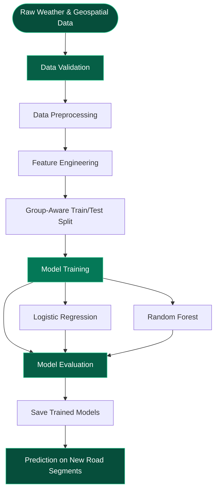

<div align="center">

# 🌧️ WATERLOGGING RISK PREDICTION

### Machine Learning for Urban Flood Vulnerability Assessment

A machine-learning pipeline designed to identify road segments around **Silk Board Junction, Bengaluru**, that are susceptible to waterlogging during rainfall events.

<br/>


<br/><br/>

**Data Engineering · Predictive Modelling · Urban Infrastructure**

</div>

---

## 📍 Overview

Urban waterlogging is a recurring infrastructure challenge in Bengaluru, particularly during periods of heavy rainfall. Inadequate drainage, low-lying terrain and high proportions of impervious surfaces can contribute to water accumulation on roads.

This project aims to address this problem through a **machine-learning-based waterlogging risk prediction pipeline**, focusing on road segments surrounding Silk Board Junction, Bengaluru.

The system analyses geographical, environmental and rainfall-related attributes to identify road segments that may be vulnerable to waterlogging during a rainfall event.

Rather than treating waterlogging as a general city-wide problem, the approach operates at an individual road-segment level, allowing more granular risk assessment.

### 🎯 Project Objectives

- Identify road segments susceptible to waterlogging during rainfall events.
- Analyse the relationship between rainfall intensity, terrain characteristics and drainage infrastructure.
- Develop a structured data preprocessing and machine-learning pipeline.
- Classify road segments into waterlogged and non-waterlogged categories.
- Evaluate model performance using classification metrics.
- Establish a foundation for future road-level risk visualisation and decision-support applications.

---

## 🚦 Project Status

<div align="center">

| Component | Status |
|:---|:---|
| Pipeline Architecture |  |
| Data Validation |  |
| Preprocessing |  |
| Model Training Modules |  |
| Automated Testing |  |
| Real-World Model Training |  |

</div>

**Important:** The pipeline has been built and tested using synthetic data. Genuine model training and meaningful performance evaluation require real, labelled waterlogging records.

---

## 🧠 Machine Learning Pipeline

The project follows a modular machine-learning architecture, separating data validation, preprocessing, model training, evaluation and prediction.



### Pipeline Stages

| Stage | Implementation |
|:---|:---|
| Data Validation | Checks column definitions, data types, missing values and allowed categorical values. |
| Preprocessing | Handles missing values, scales numerical features and encodes categorical variables. |
| Data Splitting | Uses `event_id`-based grouping to prevent rainfall-event data leakage between training and testing sets. |
| Model Training | Trains Logistic Regression and Random Forest classifiers. |
| Model Evaluation | Calculates Precision, Recall, F1-score and Confusion Matrix. |
| Model Persistence | Saves trained models as `.pkl` files for subsequent predictions. |
| Prediction | Loads a saved model to assess new road segments. |

---

## 📊 Input Features & Data Requirements

The prediction system relies on a combination of geographical, environmental and rainfall-related features.

### Required Features

| Feature | Description |
|:---|:---|
| `road_id` | Unique identifier for each road segment. |
| `event_id` | Identifier for the corresponding rainfall event. |
| `latitude` | Road segment centroid latitude (WGS-84). |
| `longitude` | Road segment centroid longitude (WGS-84). |
| `elevation_m` | Elevation above sea level in metres. |
| `slope_pct` | Road slope expressed as a percentage. |
| `rainfall_mm_hr` | Rainfall intensity during the event. |
| `rainfall_mm_24h` | Total rainfall recorded during the preceding 24 hours. |
| `drain_density` | Drainage length per unit area. |
| `imperv_pct` | Percentage of impervious surface. |
| `land_cover` | Land classification surrounding the road segment. |
| `road_type` | Classification of the road segment. |
| `waterlogged` | Target variable: `1` = waterlogged, `0` = not waterlogged. |

### Optional Features

Additional attributes can improve the richness of the input dataset:

| Feature | Description |
|:---|:---|
| `road_width_m` | Road width in metres. |
| `speed_limit_kmh` | Posted speed limit. |
| `last_cleaned_days` | Number of days since the last drainage cleaning. |

### Data Sources to Explore

The following sources can help obtain the required geographical and environmental information:

- **SRTM Digital Elevation Model:** Terrain elevation and slope.
- **Satellite Imagery:** Land-cover classification and impervious surface estimation.
- **BBMP Records:** Stormwater drainage infrastructure and flood-related complaints.
- **BWSSB Records:** Relevant water infrastructure information.
- **Rainfall Records:** Historical rainfall intensity and accumulation data.
- **Field Surveys:** Ground-truth waterlogging observations.

These are potential data sources; they should not be interpreted as already integrated or verified within the pipeline.

---

## 📁 Expected Dataset Format

The pipeline expects a CSV file containing the required features.

Example:

```csv
road_id,event_id,latitude,longitude,elevation_m,slope_pct,rainfall_mm_hr,rainfall_mm_24h,drain_density,imperv_pct,land_cover,road_type,waterlogged
SB_001,EVT_2023_06_15,12.9174,77.6219,912.0,1.2,38.5,95.0,0.42,85.0,commercial,arterial,1
SB_002,EVT_2023_06_15,12.9201,77.6244,908.5,0.8,38.5,95.0,0.65,72.0,residential,collector,0
SB_001,EVT_2023_08_22,12.9174,77.6219,912.0,1.2,12.0,25.0,0.42,85.0,commercial,arterial,0
```

**Categorical values**

`land_cover` must use one of:

- `residential`
- `commercial`
- `road`
- `green`
- `water`
- `industrial`
- `mixed`

`road_type` must use one of:

- `arterial`
- `collector`
- `local`
- `highway`

### Why is `event_id` important?

The same road segment can appear in multiple rainfall events.

For example, `SB_001` may be waterlogged during one rainfall event but remain unaffected during another.

The pipeline uses group-aware splitting based on `event_id` to prevent records from the same rainfall event from appearing in both training and testing sets.

This helps reduce data leakage and provides a more meaningful evaluation of model generalisation across rainfall events.

---

## 🛠️ Tech Stack

| Technology | Purpose |
|:---|:---|
| Python 3.13 | Core programming language |
| Pandas | Data manipulation and processing |
| NumPy | Numerical computations |
| Scikit-learn | Preprocessing, model training and evaluation |
| Joblib / Pickle | Model persistence |
| Pytest | Automated testing |

---

## 📂 Project Structure

```text
detect-rainwater-clogging/
│
├── data/
│   ├── raw/                  # Input CSV datasets
│   └── processed/            # Processed training/test data
│
├── models/                   # Saved ML models (.pkl)
│
├── notebooks/                # Exploratory data analysis
│
├── src/
│   ├── schema.py             # Column definitions and allowed values
│   ├── validate.py           # Data quality validation
│   ├── preprocess.py         # Cleaning, encoding and scaling
│   ├── train.py              # Logistic Regression and Random Forest
│   ├── evaluate.py           # Classification metrics
│   └── predict.py            # Prediction using saved models
│
├── tests/
│   ├── conftest.py           # Synthetic test data fixtures
│   ├── test_validate.py      # Validation tests
│   ├── test_preprocess.py    # Preprocessing tests
│   └── test_train.py         # Training tests
│
├── run_pipeline.py           # Main pipeline entry point
├── requirements.txt          # Project dependencies
└── README.md
```

---

## 🚀 Getting Started

Follow these instructions to clone the repository and execute the pipeline locally.

### 1. Prerequisites

- Python 3.13
- Git
- pip

### 2. Clone the Repository

```bash
git clone https://github.com/Conformitty/detect-rainwater-clogging.git

cd detect-rainwater-clogging
```

### 3. Create a Virtual Environment

**Windows:**

```bash
python -m venv .venv
.venv\Scripts\activate
```

**macOS / Linux:**

```bash
python3 -m venv .venv
source .venv/bin/activate
```

### 4. Install Dependencies

```bash
pip install -r requirements.txt
```

Verify the installation:

```bash
python -c "import sklearn, pandas, numpy; print('Environment ready!')"
```

---

## ▶️ Running the Pipeline

Once the labelled CSV dataset is available, place it inside `data/raw/`.

For example:

```text
data/
└── raw/
    └── silk_board_data.csv
```

### Execute the complete pipeline

```bash
python run_pipeline.py --data data/raw/silk_board_data.csv
```

### Run with additional options

```bash
python run_pipeline.py ^
    --data data/raw/silk_board_data.csv ^
    --test-size 0.2 ^
    --models-dir models/ ^
    --save-processed
```

The above multiline command uses Windows CMD syntax. For PowerShell or macOS/Linux, use a single line or replace `^` with `\`.

### What happens during execution?

1. **Validation:** Checks the input dataset for schema and data-quality issues.
2. **Splitting:** Separates training and testing data using `event_id` groups.
3. **Preprocessing:** Handles missing values, encodes categorical features and scales numerical features.
4. **Training:** Fits Logistic Regression and Random Forest classifiers.
5. **Evaluation:** Calculates Precision, Recall, F1-score and Confusion Matrix.
6. **Persistence:** Saves trained `.pkl` model files in the specified models directory.

### Validate the dataset independently

To check data quality without starting model training:

```bash
python -m src.validate data/raw/silk_board_data.csv
```

---

## 📈 Model Evaluation

The pipeline evaluates the trained classifiers using standard classification metrics.

| Metric | Purpose |
|:---|:---|
| Precision | Measures how many predicted waterlogging cases are actually waterlogged. |
| Recall | Measures how many actual waterlogging cases are successfully identified. |
| F1-score | Balances precision and recall. |
| Confusion Matrix | Shows correct and incorrect classifications for both classes. |

### Why Recall Matters

In this application, missing a genuinely waterlogged road segment can be more consequential than incorrectly flagging a safe segment.

Therefore, **Recall for class `1` (waterlogged)** is particularly important when evaluating the model.

However, precision must also be considered to avoid excessive false alarms.

No real-world accuracy or performance claims are made until the model is trained and evaluated on genuine labelled data.

---

## 🧪 Running Tests

The repository includes a dedicated test suite to verify the functionality of individual pipeline components.

The tests use synthetic data fixtures and are intended to validate implementation correctness, not real-world predictive performance.

Run the complete test suite:

```bash
python -m pytest tests/ -v
```

### Test Modules

| Test File | Purpose |
|:---|:---|
| `test_validate.py` | Tests dataset validation logic. |
| `test_preprocess.py` | Tests preprocessing and feature transformations. |
| `test_train.py` | Tests model training functionality. |
| `conftest.py` | Provides synthetic datasets for testing. |

---

## 🔮 Making Predictions

Once genuine labelled data has been used to train and save the models, the prediction module can be used to assess new road segments.

### Predicting from a CSV file

```python
from src.predict import predict_from_csv

results = predict_from_csv(
    model_path="models/random_forest.pkl",
    data_path="data/raw/new_roads.csv"
)

print(
    results[
        ["road_id", "predicted_waterlogged", "prob_waterlogged"]
    ]
)
```

### Predicting an Individual Road Segment

```python
from src.predict import predict_single_road

result = predict_single_road(
    model_path="models/random_forest.pkl",
    road_data={
        "road_id": "SB_099",
        "event_id": "EVT_FORECAST",
        "latitude": 12.917,
        "longitude": 77.622,
        "elevation_m": 912.0,
        "slope_pct": 1.2,
        "rainfall_mm_hr": 35.0,
        "rainfall_mm_24h": 80.0,
        "drain_density": 0.45,
        "imperv_pct": 78.0,
        "land_cover": "commercial",
        "road_type": "arterial"
    }
)

print(result)
```

The prediction module is designed to return the predicted class and associated probability information.

An illustrative output might look like:

```json
{
    "predicted_waterlogged": 1,
    "prob_waterlogged": 0.82,
    "risk_label": "HIGH RISK"
}
```

*The values above are illustrative only, not actual model predictions.*

The prediction interface can also serve as the foundation for a future Streamlit application.

---

## ⚠️ Limitations & Considerations

The following limitations are important when interpreting the project's current capabilities.

| Limitation | Explanation |
|:---|:---|
| Real Labelled Data | Genuine model training requires verified historical waterlogging observations. |
| Synthetic Test Data | Current automated tests use synthetic data and cannot establish real-world accuracy. |
| Binary Classification | The current target distinguishes waterlogged from non-waterlogged conditions; it does not estimate flood depth or duration. |
| Static Prediction | The pipeline does not currently model the time-series progression of a rainfall or flooding event. |
| Spatial Relationships | Nearby road segments are not explicitly modelled for spatial autocorrelation. |
| Geographic Scope | The current study focuses on the Silk Board region and is not automatically generalisable to other locations. |
| Hyperparameter Tuning | Systematic hyperparameter optimisation is a future improvement. |

**Important:** Model predictions should be treated as experimental risk assessments, not verified flood warnings or substitutes for official emergency information.

---

## 🛣️ Roadmap

The project can be extended through the following development stages:

- [x] Design modular ML pipeline architecture.
- [x] Implement dataset schema and validation.
- [x] Implement preprocessing and feature transformations.
- [x] Develop Logistic Regression and Random Forest training modules.
- [x] Implement classification evaluation metrics.
- [x] Develop prediction functionality.
- [x] Create automated tests using synthetic data.
- [ ] Acquire genuine, labelled waterlogging records.
- [ ] Train and evaluate models using real-world observations.
- [ ] Perform hyperparameter tuning and feature analysis.
- [ ] Develop an interactive Streamlit interface.
- [ ] Integrate geospatial road-level risk visualisation.
- [ ] Explore SUMO traffic simulation for assessing potential mobility impacts.

---

## 🤝 Contributing

Contributions, suggestions and improvements are welcome.

1. Fork the repository.
2. Create a feature branch.
3. Commit your changes.
4. Push the branch to your fork.
5. Open a Pull Request.

For changes involving model training or data processing, please include relevant tests wherever possible.

---

<div align="center">

### 🌍 DATA-DRIVEN INSIGHTS FOR SMARTER CITIES

**Built with Python · Machine Learning · Data Science**

<br/>

[](https://github.com/Conformitty)

<sub>Silk Board Waterlogging Risk Prediction · Bengaluru, India · 2026</sub>

</div>
